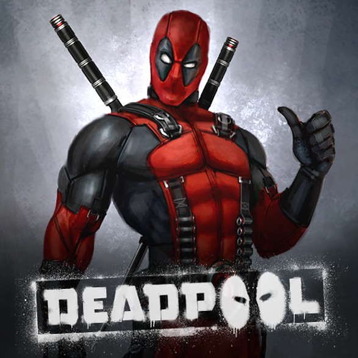

<div align=center>



</div>
<h1 align=center>Deadpool — Nintendo Switch port</h1>

A native Nintendo Switch port of the Xbox 360 version of **Deadpool** (2013, High Moon Studios / Activision).

It's not an emulator. The PowerPC code of the game's `default.xex` is statically recompiled to C++ with
[ReXGlue](https://github.com/rexglue/rexglue-sdk) and compiled for the Switch, and the game is drawn natively on the
Switch's own graphics API, deko3d, by Renut's Direct3D-level renderer (from
[reNut](https://github.com/masterspike52/reNut), built on
[renut_nx_ultimate_base](https://github.com/ChanseyIsTheBest/renut_nx_ultimate_base)). It targets **30 FPS at the
console's stock clocks** with no overclock required.

> [!NOTE]
> You need your own legally obtained copy of the Xbox 360 game (`Title ID: 415608EC`): the extracted disc files
> (`default.xex` and the `TransGame/` directory). This repository contains no original game assets or binaries.

## How to install

1. Prepare the release package (`deadpool.nro`, `deadpool.toml`, `deko3d_glsl.bin`, and `deko3d_shaders.bin`) and copy
   it to `sdmc:/switch/deadpool-nx/`.
2. Copy your extracted Xbox 360 game files (`default.xex` and `TransGame/`) into
   `sdmc:/switch/deadpool-nx/game/` (both `game/` and `game_root/` are supported).

Your `deadpool-nx` folder on the SD card should look like this:

```text
/switch/deadpool-nx/
  deadpool.nro
  deadpool.toml             (your settings)
  deko3d_glsl.bin           (13,307 translated deko3d GLSL shaders)
  deko3d_shaders.bin        (26,394 precompiled Switch GPU shader variants)
  dlc/                      (optional: place your Xbox 360 DLC package file here)
  game/                     (the files from your Xbox 360 disc; game_root/ is also supported)
    default.xex
    TransGame/
```

Launch the game using **Title Override** (hold **R** while starting any installed Switch game) or an NSP forwarder.
**Album applet mode does not provide enough memory.** If you create a forwarder (for example with
[Sphaira](https://github.com/NaGaa95/sphaira)), make sure it is configured with a **39-bit address space**.

To build the project from source yourself, see [docs/building.md](docs/building.md).

> [!TIP]
> The release package includes a precompiled `deko3d_shaders.bin` cache covering **26,394 GPU shader variants** across
> all 13,307 Unreal Engine 3 shaders in the game's `.xxx` packages, eliminating first-run shader compilation stutter. Any
> new pipeline variant encountered during gameplay is automatically appended to `deko3d_shaders.bin` on the SD card.

## Controls

By default (`input_xbox_layout = false`), the Switch physical face buttons follow the standard Nintendo Switch layout by
position, and the in-game Momentum combo HUD icons (`LB + A / B / X / Y`) are automatically patched in memory to match
the physical Switch button labels on your controller:

<div align="center">

| Switch Physical Button | Xbox 360 Action | In-Game Action |
| --- | --- | --- |
| **B** (bottom) | A | Jump / Confirm (`LB + B` Momentum 1) |
| **A** (right) | B | Dodge / Teleport / Cancel (`LB + A` Momentum 4) |
| **Y** (left) | X | Light Attack (`LB + Y` Momentum 2) |
| **X** (top) | Y | Heavy Attack / Shoot (`LB + X` Momentum 3) |
| **ZR / ZL** | RT / LT | Aim / Fire Ranged Weapons |
| **R / L** | RB / LB | Sub-weapon / Momentum Modifier |
| **+** | Start | Pause Menu |
| **−** | Back | Upgrades Menu |
| **+ & −** (together) | — | Quick Menu (FPS counter, Profiler, Frame Diagnostics) |
| **Sticks / D-pad** | Sticks / D-pad | Move / Camera / Weapon Select |

</div>

To map buttons by letter instead (`A -> A`, `B -> B`, `X -> X`, `Y -> Y`), set `input_xbox_layout = true` in
`deadpool.toml`.

## Language

Set `language` in `sdmc:/switch/deadpool-nx/deadpool.toml` to choose the in-game language:

```toml
language = "english"
```

Supported values:

- `"english"` *(default)* — English (`en`, `int`, `1`)
- `"german"` — Deutsch (`de`, `deu`, `deutsch`, `3`)
- `"french"` — Français (`fr`, `fra`, `francais`, `4`)
- `"spanish"` — Español (`es`, `esn`, `espanol`, `5`)
- `"italian"` — Italiano (`it`, `ita`, `italiano`, `6`)
- `"auto"` — Automatically match the Nintendo Switch system language (`0`; falls back to English for unsupported console languages)

## DLC

The port supports your own legally obtained Xbox 360 **Merc with a Map Pack** DLC (`Title ID: 415608EC`, STFS marketplace package `4FDD44B4873E403EEC092AC2DC69005412111A1F41`), which adds:

- **2 Challenge Maps:** *GRT Plaza* and *Inside the Tower*
- **2 Suits (unlocked after beating the story):** *D-Pooly* and *Uncanny X-Force*

How to install:

1. Create `sdmc:/switch/deadpool-nx/dlc/` on your SD card.
2. Copy your Xbox 360 STFS DLC package file into `sdmc:/switch/deadpool-nx/dlc/`.
3. Launch the game normally. On startup, the port automatically extracts and installs valid `Title ID 415608EC` marketplace packages into its internal content storage (`renut/`). Files belonging to Xbox 360 Dashboard Avatar items or other games are automatically skipped.

To temporarily disable DLC loading without deleting your files (saves are unaffected), set `dlc_enabled = false` in `deadpool.toml`.

## Settings

`deadpool.toml`, located next to `deadpool.nro`, holds the runtime configuration:

<div align="center">

| Setting | Default | What it does |
| --- | --- | --- |
| `language` | `"english"` | In-game language: `"auto"`, `"english"`, `"german"`, `"french"`, `"spanish"`, or `"italian"` |
| `dlc_enabled` | `true` | Enable installing and exposing Xbox 360 marketplace DLC packages (`false` hides DLC without touching saves) |
| `renut_dlc_folder` | `"dlc"` | Folder next to `deadpool.nro` scanned on startup for Xbox 360 DLC packages |
| `banjo_renut_render_height_handheld` | `720` | Internal rendering height in handheld mode (`1280x720`) |
| `banjo_renut_render_height_docked` | `1080` | Internal rendering height in docked mode (`1920x1080`; set to `720` for lower GPU load docked) |
| `banjo_renut_dynamic_resolution` | `true` | Adaptive dynamic resolution scaling (`486p–720p` handheld, `720p–1080p` docked) to maintain 30 FPS under heavy load |
| `deadpool_system_core_max_pct` | `20` | Maximum duty-cycle cap (%) for background XMA audio decoding on Switch Core 3 |
| `input_xbox_layout` | `false` | `false`: physical Xbox button positions with Switch Momentum HUD icons; `true`: match by button letter |
| `input_joycon_sideways` | `true` | Allow single Joy-Con sideways grip |
| `banjo_renut_resolve_skip` | `true` | Skip redundant EDRAM resolves where target contents are already current |
| `deadpool_perf_log` | `false` | Write periodic frame-time and CPU/GPU diagnostic telemetry to `logs/` |

</div>

## Resolution and Performance

- **Resolution:** Renders up to **1280x720** in handheld mode (matching the native Xbox 360 resolution) and **1920x1080**
  when docked, with adaptive dynamic resolution scaling (**486p–720p** handheld, **720p–1080p** docked) during heavy
  GPU/CPU scenes when `banjo_renut_dynamic_resolution = true`.
- **Frame Rate:** Targets the original game's **30 FPS cap** at stock Switch clocks:

<div align="center">

| Mode | CPU | GPU | Memory |
| --- | --- | --- | --- |
| Handheld | 1020 MHz | 460.8 MHz | 1331.2 MHz |
| Docked | 1020 MHz | 768 MHz | 1600 MHz |

</div>

## Overclocking

The port is designed to run at stock clocks **with no overclock**. On heavier combat arenas, a mild CPU/GPU clock boost
via `sys-clk` or `Horizon OC` can help maintain a locked 30 FPS under peak load.

> [!CAUTION]
> Overclocking pushes the console beyond what it was designed for and you do it at your own risk. An unstable memory
> overclock can corrupt the NAND or the SD card: make a backup first and test every change.

Community guides:
- **[How to get 60 FPS](https://rentry.org/howtoget60fps)**: tools and setup (Horizon OC, Ultrahand, Status Monitor).
- **[Mariko guide](https://rentry.co/mariko)**: Switch V2, Lite, and OLED.
- **[Erista guide](https://rentry.co/erista)**: original 2017 Switch.

## How it works

- **Static recompilation, not emulation.** [ReXGlue](https://github.com/rexglue/rexglue-sdk) translates every PowerPC
  function of `default.xex` to C++, compiled directly to AArch64 machine code with LTO and localized hot-function copies
  (`app/generated/hot/`).
- **Native deko3d renderer.** The game's Direct3D 9 / Xbox 360 command streams are rendered directly on the Switch's
  Maxwell GPU via Renut's Direct3D-level renderer and [plume](https://github.com/renderbag/plume)'s deko3d backend — no
  Xbox 360 GPU command processor emulation and no Vulkan translation layer.
- **Unreal Engine 3 Xenos EDRAM & HDR pipeline.** Accurately handles Xbox 360 `D3DFMT_A2B10G10R10F_EDRAM` (`7e3` float
  HDR render targets) with `2^3` exponent bias across UE3 scene color, bloom/exposure gather, radial blur, and Near-Death
  vignette post-process passes (`view_fp10_encode_ps.hlsl`).
- **Complete offline shader library.** All **13,307** vertex and pixel shaders extracted from the game's executable and
  cooked `.xxx` packages are translated with [XenosRecomp](https://github.com/hedge-dev/XenosRecomp), DXC, and
  SPIRV-Cross into optimized deko3d GLSL (`deko3d_glsl.bin`) and precompiled with
  [uam](https://github.com/devkitPro/uam) into **26,394** native Maxwell shader binaries (`deko3d_shaders.bin`).
- **Audio, Physics & CPU optimizations.** ARM64 NEON-vectorized audio resampling, XMA voice packet decoding, FMOD
  5.1/multi-channel mixing, and PhysX PGS constraint solvers, native `libmspack` LZX streaming decompression, `plume`
  CPU/GPU heap reserve protection, fast AArch64 VMX estimates, single-mode FPCR float execution, and verified
  stack-slot vector forwarding.

## Build

Requires Windows, LLVM/Clang and Visual Studio Build Tools for code generation and host tools; devkitA64, libnx, and
deko3d from [devkitPro](https://devkitpro.org) for the Switch target; Python 3; and your own Xbox 360 copy of the game.
Full build instructions are in [docs/building.md](docs/building.md).

<div align="center">

| Folder | Contents |
| --- | --- |
| `app/` | Game layer, hooks, hot-function shards, Renut deko3d renderer (`app/src/renut_engine/gpu`), XenosRecomp, CMake project |
| `sdk/` | ReXGlue SDK with the Nintendo Switch Horizon OS layer, XMA audio decoder, VFS patches, and codegen passes |
| `tools/` | Post-codegen optimization passes (`stack_forward.py`, `single_floats.py`, `vmx_forms.py`), shader extraction & DKSH cache builders |
| `dist/` | Default Switch runtime configuration (`dist/switch/deadpool-nx/deadpool.toml`) |
| `docs/` | Technical documentation and porting guides ([docs/README.md](docs/README.md)) |

</div>

## Credits

- **High Moon Studios and Activision** — creators of *Deadpool* (2013). This is an unofficial, fan-made port with no
  affiliation.
- **[BanhMi93P](https://github.com/BanhMi93P)** — Deadpool Nintendo Switch port (`deadpool-nx`), UE3 renderer/HDR pipeline fixes, full 13,307 shader package & DKSH variant cache, Switch Momentum HUD patches, and codegen fixes.
- **[ChanseyIsTheBest](https://github.com/ChanseyIsTheBest/renut_nx_ultimate_base)** — `renut_nx_ultimate_base` and the
  sibling Xbox 360 Switch ports (`banjo-nx`, `katamari-nx`, `sa2-nx`, `sasrt-nx`, `blur-nx`, `kameo-nx`, `halo3-nx`,
  `vivapinata-nx`, `rr6-nx`).
- **[Tom Clay](https://github.com/rexglue/rexglue-sdk)** — the ReXGlue SDK, built on the work of the
  **[Xenia](https://xenia.jp)** team.
- **[masterspike52](https://github.com/masterspike52/reNut)** — reNut's Direct3D-level renderer.
- **[StevensND](https://github.com/StevensND/nfsmw-nx)** — `nfsmw-nx`: the Switch layer of the SDK and profiling tools.
- **[hedge-dev](https://github.com/hedge-dev/XenosRecomp)** — XenosRecomp, the Xenos shader translator.
- **[renderbag](https://github.com/renderbag/plume)** — plume; **[fincs](https://github.com/devkitPro/deko3d)** —
  deko3d and [uam](https://github.com/devkitPro/uam).
- **[devkitPro](https://devkitpro.org) and [switchbrew](https://github.com/switchbrew/libnx)** — devkitA64 and libnx.
- The other libraries listed in [THIRD_PARTY_NOTICES.md](THIRD_PARTY_NOTICES.md).

## Legal

No affiliation with Activision, Marvel, High Moon Studios, Microsoft, or Nintendo. "Deadpool" is a trademark of Marvel
Characters, Inc. This repository contains no assets or program code from the original game. Users must provide their own
legally obtained copy of the Xbox 360 disc. Running homebrew requires custom firmware, which violates Nintendo's Terms of
Service and can result in a console ban — proceed at your own risk.

Source code is provided under the GPL-3.0 License (see [LICENSE](LICENSE)). The SDK retains its BSD-3-Clause license
(see [THIRD_PARTY_NOTICES.md](THIRD_PARTY_NOTICES.md)).
